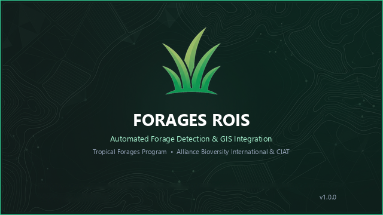
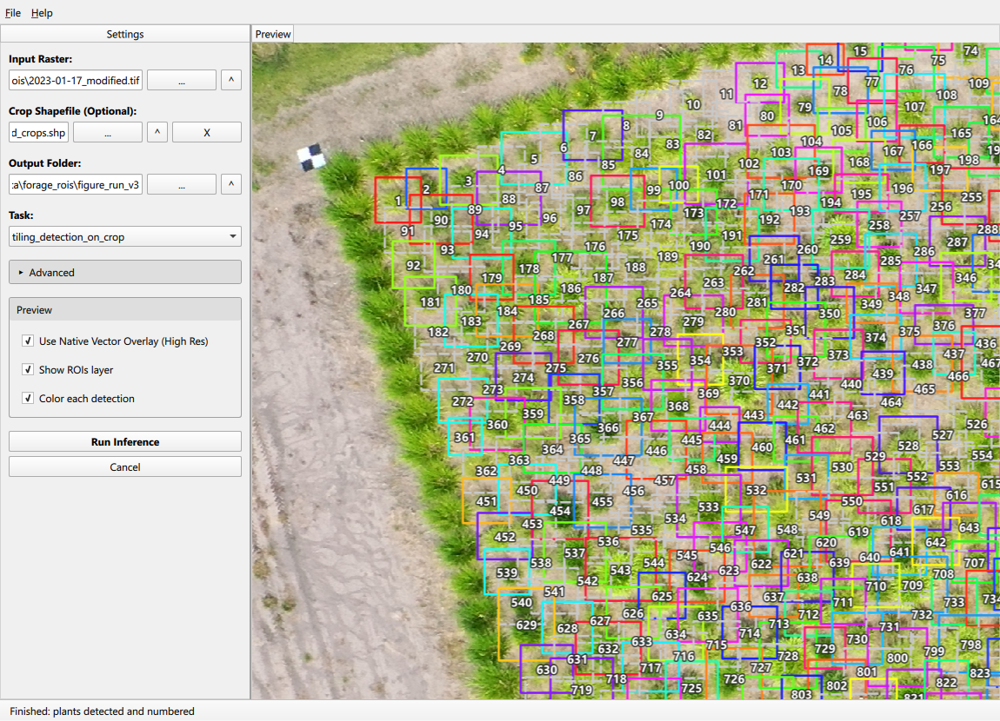

# ForagesROIs

ForagesROIs finds every forage plant in an RGB orthomosaic of a field trial, numbers the plants in the order of the field book and measures their canopy. It runs as a desktop application (GUI), from the command line (CLI) or from QGIS through the launcher plugin.

## What it does

1. **Crop fields** (`crop_detection`): finds the field polygons in the orthomosaic.
2. **Plants** (`tiling_detection_on_crop` or `tiling_detection`): cuts the orthomosaic into tiles, detects each plant (*Urochloa* or *Megathyrsus*) and merges the tiles.
3. **Numbering**: numbers the plants row by row in serpentine order from a corner. Optionally (**Empty plots for missing plants**), it numbers the planting positions instead: a position without a detected plant becomes an *empty plot* with its own number, so the numbers still match the field book when plants are missing.
4. **Plant traits** (`plant_traits`): outlines the canopy of each plant and reports its area and cover, with a CSV table ready to join to the field book.

## Requirements

- Windows 10 or 11, 64 bit.
- NVIDIA GPU with a driver that supports CUDA 12.9 (detection runs on the GPU).
- Orthomosaic (GeoTIFF) of **1 to 3 cm per pixel**: RGB, or with more bands (multispectral) choosing which are red, green and blue. The models were trained on orthomosaics of 1 to 2 cm per pixel; with much larger pixels the plants are too small to detect.

## Install

1. Download `ForagesROIs.dist.zip` from the [latest release](https://github.com/afruizh/forages_rois/releases).
2. Unzip it to a folder of your choice (not inside a synced cloud folder).
3. Run `ForagesROIs.exe`. No installation or Python is needed. The models are in the `models` folder next to the executable.

## Quick start

1. Open `ForagesROIs.exe`, choose the orthomosaic as **Input Raster** and an **Output Folder**.
2. Run the task `crop_detection`.
3. Run the task `tiling_detection_on_crop` (it uses the crop fields from step 2).
4. Optionally run `plant_traits` with the numbered shapefile as **Input Shapefile**.
5. Open the shapefiles in QGIS. A style file (`.qml`) is written next to each one, so QGIS shows the plot numbers as labels.

## Pages

- [Desktop application (GUI)](gui.md)
- [Command line (CLI)](cli.md)
- [Outputs](outputs.md)
- [Models](models.md)
- [Scripts and AI agents](agents.md)

## Authors

Developed by the **Tropical Forages Program** of the **Alliance Bioversity International & CIAT**.

Code: [github.com/afruizh/forages_rois](https://github.com/afruizh/forages_rois), under the Apache License 2.0. Models: [Hugging Face](https://huggingface.co/anfruizhu/forages-rois-models), under AGPL-3.0 (see [Models](models.md)).
